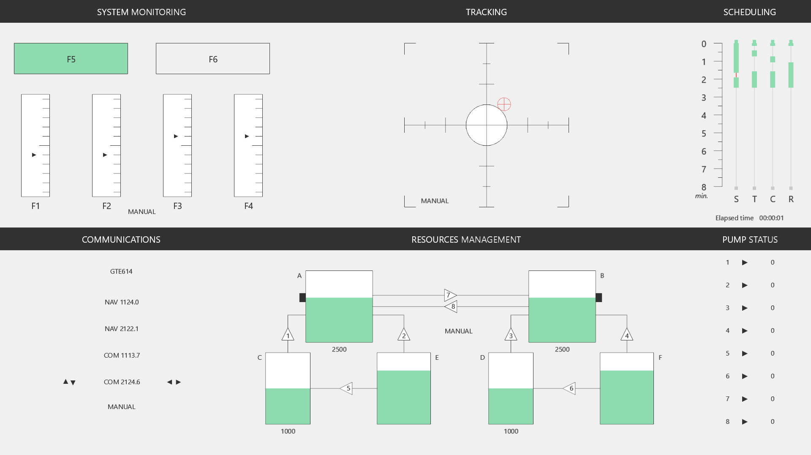

[](https://github.com/juliencegarra/OpenMATB/actions/workflows/tests.yml)


> [!NOTE]
> **Web version.** Since version 1.5, OpenMATB also runs in a web browser, with no installation, thanks to Pyodide and pyglet 3 ([try the demo](https://juliencegarra.github.io/OpenMATB/)). Chrome or Edge are recommended: Firefox and Safari also work, but Firefox pauses the page for 0.1 to 1 s every few seconds, which affects timing. Joysticks are supported through the browser Gamepad API. Session files are downloaded, or sent to JATOS, DataPipe (Google Drive, Dataverse or Zenodo) or a WebDAV folder, and can be replayed in the browser; OpenMATB can also run from an LMS (SCORM, cmi5). A USB trigger box replaces the parallel port, and Lab Streaming Layer goes through a bridge. Response times are measured from the frame showing the stimulus to the browser timestamp of the key; screen and keyboard latencies are not measured. See [WEB.md](WEB.md) to build and host it.

# OpenMATB: An open-source version of the Multi-Attribute Task Battery (MATB)

First presented at a NASA Technical memorandum (Comstock & Arnegard, 1992), the Multi-Attribute Task Battery (MATB) contained a set of interactive tasks that were representative of those performed in aircraft piloting. The MATB requires participants to engage in four tasks presented simultaneously on a computer screen. They consist of (1) a monitoring task, (2) a tracking task, (3) an auditory communication task, and (4) a resources management task. The display screen also encompasses a scheduling view (5) for displaying a chart of incoming task events




More than thirty years have passed since the first implementation of the MATB (Comstock & Arnegard, 1992), and some requirements of up to date research are no longer satisfied.

OpenMATB aims to provide an open-source re-implementation of the multi-attribute task battery. It promotes three aspects:
1. tasks customization for full adaptation of the battery,
2. software extensibility to easily add new features,
3. experiment replicability to provide significant results.

Those aspects are detailed in:

Cegarra, J., Valéry, B., Avril, E., Calmettes, C., & Navarro, J. (2020) OpenMATB: A Multi-Attribute Task Battery promoting task customization, software extensibility and experiment replicability. *Behavior Research Methods*, 52, 1980–1990. https://doi.org/10.3758/s13428-020-01364-w


Contact : <a href="mailto:julien.cegarra@univ-jfc.fr">julien.cegarra AT univ-jfc.fr</a>


## Installation

- **Windows, no Python needed**: the [installer](https://github.com/juliencegarra/OpenMATB/releases/latest/download/OpenMATB-Setup.exe) or the [portable version](https://github.com/juliencegarra/OpenMATB/releases/latest/download/OpenMATB-Portable.zip) of the [latest release](https://github.com/juliencegarra/OpenMATB/releases/latest).
- **In a web browser**: [try the demo](https://juliencegarra.github.io/OpenMATB/#demo); the releases also contain the web version ready to host (static site, JATOS study, SCORM and cmi5 packages, see [WEB.md](WEB.md)).
- **From the source code** (Windows, macOS, Linux): with [Python 3.10](https://www.python.org/downloads/) or above, clone this repository, then:

```bash
python -m pip install -r requirements.txt   # pyglet 2, pyparallel, rstr, pylsl
python main.py
```

(Under Windows, replace `python` with `py`.) To install OpenMATB in a virtual environment, see [How to install OpenMATB](https://github.com/juliencegarra/OpenMATB/wiki/How-to-install-OpenMATB%3F). A joystick is recommended for the tracking task.

## Usage

OpenMATB runs a *scenario*: a text file of `includes/scenarios` listing, for each task, the events to execute and their onset time. For instance, this scenario starts the four tasks of the MATB and the scheduling view, and stops them after two minutes and a half:

```
0:00:00;sysmon;start
0:00:00;track;start
0:00:00;scheduling;start
0:00:00;resman;start
0:00:00;communications;start
0:02:30;sysmon;stop
0:02:30;track;stop
0:02:30;communications;stop
0:02:30;resman;stop
0:02:30;scheduling;stop
```

The scenario to run is set by `scenario_path` in `config.ini` (empty: it is chosen in a selector at start), or given on the command line:

```bash
python main.py myexperiment/scenario_1.txt   # Run this scenario (in includes/scenarios)
python main.py -r                            # Replay a session, chosen in a selector
python main.py -r 12                         # Replay the session 12 (or give the path of a session file)
```

What happened during the session is stored as a CSV file in the `sessions` directory: everything needed to compute the performance, or to replay the session.

## Documentation

- [The website](https://juliencegarra.github.io/OpenMATB/): [building a scenario](https://juliencegarra.github.io/OpenMATB/#build-scenario), [the tasks](https://juliencegarra.github.io/OpenMATB/#tasks), [psychophysiology](https://juliencegarra.github.io/OpenMATB/#psychophysiology), [the replay](https://juliencegarra.github.io/OpenMATB/#replay), [the web version](https://juliencegarra.github.io/OpenMATB/#web), and the publications using OpenMATB
- [The wiki](https://github.com/juliencegarra/OpenMATB/wiki): the details of each task and plugin, [the scenario file](https://github.com/juliencegarra/OpenMATB/wiki/How-to-build-a-scenario-file), [the configuration file](https://github.com/juliencegarra/OpenMATB/wiki/The-configuration-file-(config.ini)), [the session file](https://github.com/juliencegarra/OpenMATB/wiki/The-session-log-file), [questionnaires](https://github.com/juliencegarra/OpenMATB/wiki/Write-a-questionnaire), [translations](https://github.com/juliencegarra/OpenMATB/wiki/Internationalization)
- [WEB.md](WEB.md): building and hosting the web version
- [CHANGELOG.md](CHANGELOG.md): the changes of each version
